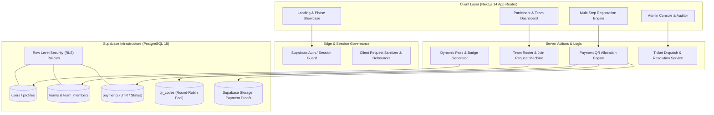

# Concurrence 2K26 — National Technical Symposium Platform

[](https://nextjs.org/)
[](https://www.typescriptlang.org/)
[](https://supabase.com/)
[](https://tailwindcss.com/)
[](https://www.framer.com/motion/)
[](https://opensource.org/licenses/MIT)

An enterprise-grade, high-throughput web application engineered to manage participant registrations, round-robin UPI payment verification, dynamic QR code routing, team collaboration, and live event ticketing for **Concurrence 2K26**, a national-level technical symposium.

---

## 🏛️ System Architecture



---

## ⚡ Engineering & Architectural Highlights

1. **Round-Robin UPI QR Load Distribution**:
   - Implements automated dynamic QR allocation across authorized treasurer accounts (`getNextAvailableQR`) to distribute transaction volume and circumvent individual UPI daily velocity limits.
2. **Deterministic Team State Machine**:
   - Team creation, invite-code generation, and member join requests adhere to strict atomic transactions with optimistic concurrency to prevent duplicate joins or team overcapacity.
3. **Database-Enforced Row-Level Security (RLS)**:
   - PostgreSQL RLS guarantees that participants cannot read other teams' payment artifacts, registration metadata, or unapproved support tickets.
4. **Idempotent Payment & UTR Reconciliation**:
   - Payments enforce unique constraint validation on Transaction Reference Numbers (UTR) to eliminate replay attacks and fraudulent multi-registration attempts.
5. **Realtime Administration & Audit Streams**:
   - Administrators monitor registration velocities, approve/reject payment slips, and manage check-in passes via reactive Supabase subscriptions.

---

## 📂 Repository Structure

```text
concurrence2k26/
├── app/
│   ├── (main)/
│   │   ├── dashboard/          # Participant team & pass dashboard
│   │   ├── faq/                # Categorized accordion FAQ
│   │   ├── login/              # OTP & credential-based participant authentication
│   │   ├── register/           # Multi-step transactional registration pipeline
│   │   ├── success/            # Dynamic payment verification confirmation
│   │   ├── support/            # Real-time participant ticketing system
│   │   └── terms/              # Legal, privacy, and refund contracts
│   ├── admin/
│   │   ├── login/              # Administrative access portal
│   │   └── main-dashboard/     # Live telemetry, UTR verification, attendee check-in
│   └── layout.tsx              # Root glassmorphism layout & global providers
├── components/
│   ├── glass-navbar.tsx        # Responsive backdrop-filter navigation
│   ├── footer.tsx              # Institutional footer & sponsor showcase
│   └── home/                   # Hero, phases, prizes, and judge showcase components
├── lib/
│   ├── supabase.ts             # Initialized Supabase singleton client
│   ├── supabase-actions.ts     # Transactional server mutations & queries
│   ├── auth.ts                 # Role-based credential verification
│   └── error-handler.ts        # Sanitized error translations
├── COMPLETE_DATABASE_SETUP.sql # Full DDL, indexes, RLS policies, and triggers
└── MASTER_SCHEMA_SETUP.sql     # Consolidated relational schema baseline
```

---

## 🗄️ Relational Database Schema & Entities

- **`users`**: Unique institutional identifier, student registration number, email, phone, and role (`STUDENT`, `ADMIN`, `SUPER_ADMIN`).
- **`teams`**: Team name, unique join code, leader reference, and active event registration.
- **`team_members`**: Junction table maintaining referential integrity with cascading delete safeguards.
- **`payments`**: Payment transaction record storing transaction ID (UTR), uploaded screenshot reference in Supabase Storage, verification status (`PENDING`, `APPROVED`, `REJECTED`), and assigned reviewer.
- **`qr_codes`**: Round-robin UPI QR asset pool tagged with allocation counters and active status.
- **`support_tickets`**: In-app query resolution pipeline with priority levels and response threads.

---

## 🚀 Local Development Setup

### Prerequisites
- Node.js 18.x or 20.x LTS
- npm or pnpm
- Active Supabase Project (or local Supabase CLI)

### 1. Clone & Install Dependencies
```bash
git clone https://github.com/ak-bharadwaj/concurrence2k26.git
cd concurrence2k26
npm install
```

### 2. Environment Variables
Create a `.env.local` file in the root directory:
```env
NEXT_PUBLIC_SUPABASE_URL=https://your-project.supabase.co
NEXT_PUBLIC_SUPABASE_ANON_KEY=your-anon-key
SUPABASE_SERVICE_ROLE_KEY=your-service-role-key
NEXT_PUBLIC_SITE_URL=http://localhost:3000
```

### 3. Database Migration
Execute `COMPLETE_DATABASE_SETUP.sql` inside your Supabase SQL Editor to provision tables, triggers, and RLS policies.

### 4. Run Development Server
```bash
npm run dev
```
Navigate to [http://localhost:3000](http://localhost:3000).

---

## 🔒 Security & Operational Integrity
- **Anti-Tamper Input Sanitization**: Form payloads are parsed and validated with strict regex patterns for college roll numbers and 12-digit UTR numbers.
- **Storage Protection**: Payment proofs are saved in a private storage bucket accessible only via signed short-lived URLs generated for authenticated reviewers.
